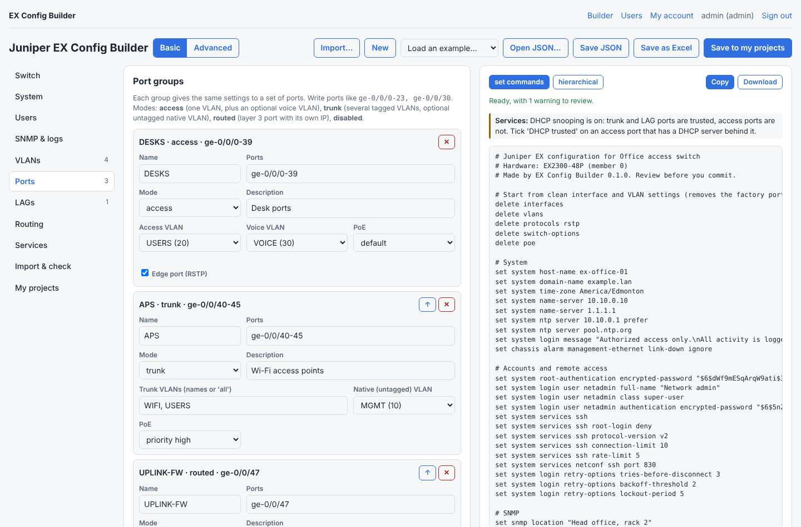
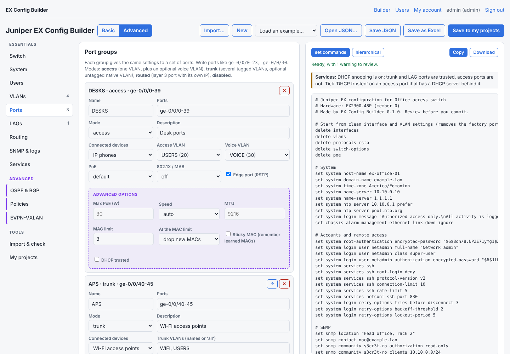
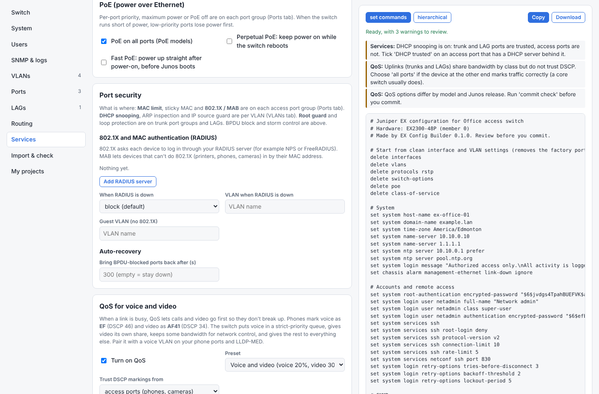
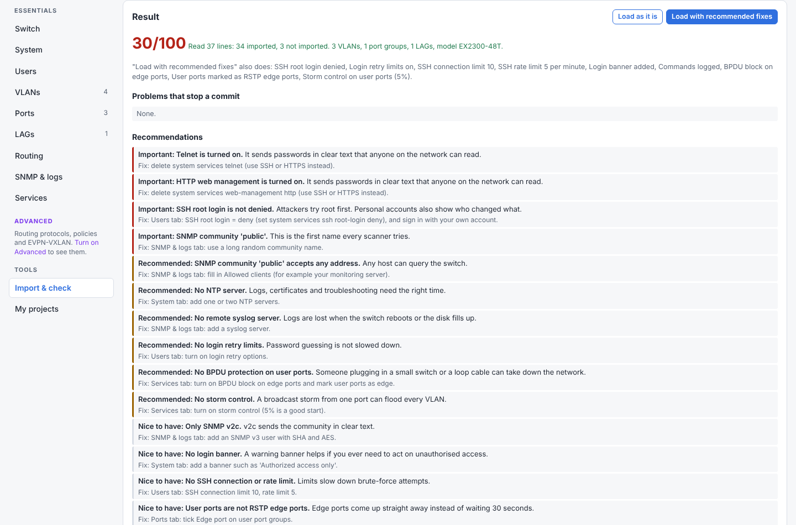
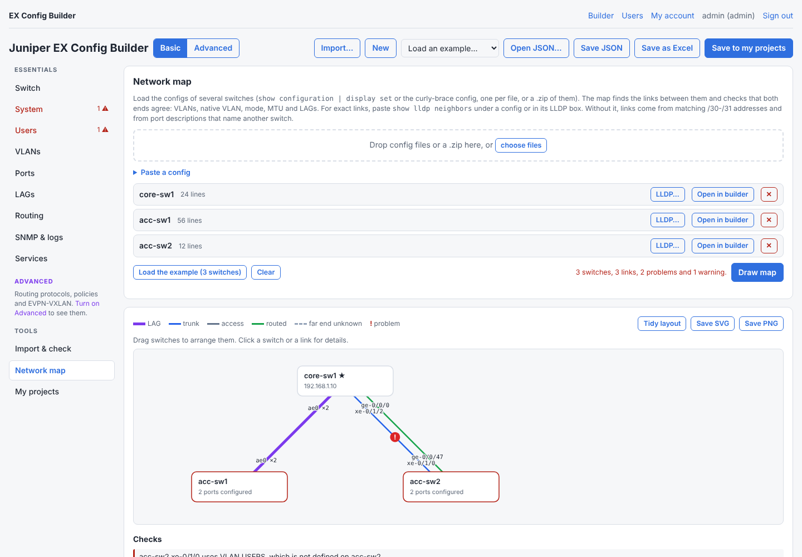
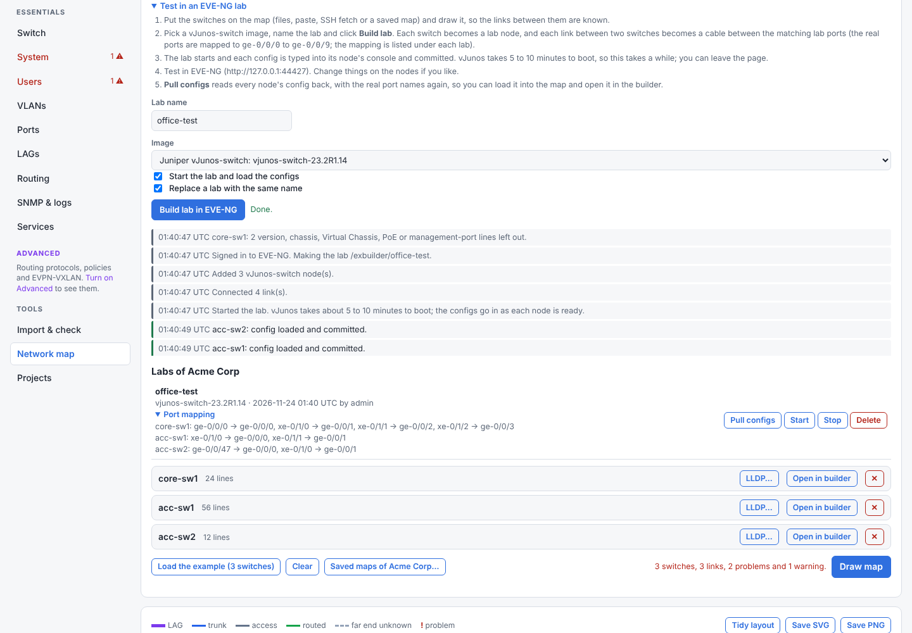
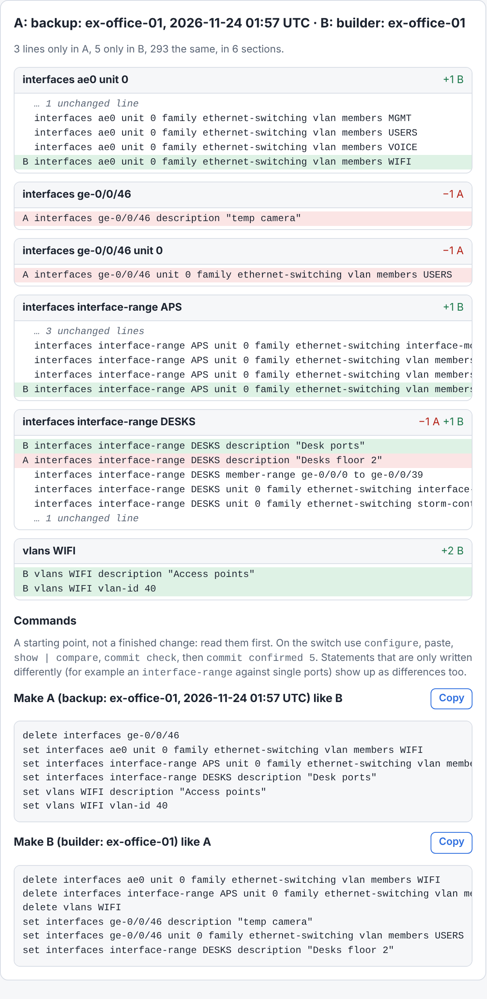
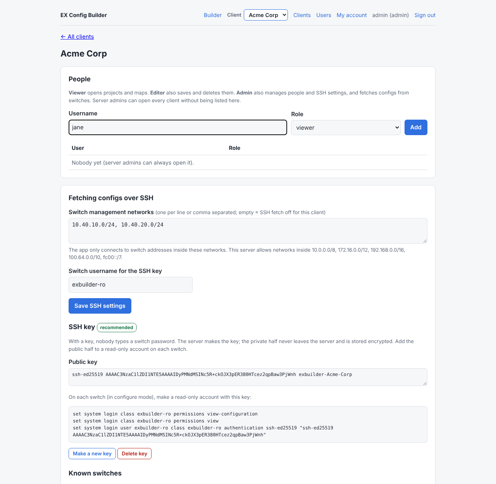

# Multi-Vendor Switch Config Builder

A web GUI (and a small CLI) that builds switch configuration. After you sign in,
pick a vendor:

| Vendor | Writes config for | Status |
|---|---|---|
| Juniper | Junos ELS: EX2300, EX3400, EX4100, EX4300, EX4400 | ready |
| Arista | EOS: 720XP, 722XPM, 7010, 7050X3, vEOS and cEOS lab | ready |
| Cisco | IOS-XE and IOS: Catalyst 9200, 9300, 9500, older 2960-X, 3650, 3850, and Cat9kv lab | ready |
| Cisco Nexus | NX-OS: Nexus 9200, 9300, older 3000, and Nexus 9000v lab | ready |
| Dell | SmartFabric OS10: N3200, N2200, S5200 and OS10 virtual lab | ready |
| Extreme Networks | EXOS / Switch Engine: X440-G2, X450-G2, X460-G2, 5320, 5420 and EXOS VM | ready |
| Fortinet FortiSwitch | FortiSwitchOS (standalone): FS-100F, 200E, 400E, 1000E | ready |
| MikroTik | RouterOS v7 script: CRS326, CRS328, CRS354, CRS310, CRS317 and CHR lab | ready |
| Brocade / Ruckus | FastIron: ICX 7000 and 6000, FCX, FGS, FLS | ready |
| HPE Aruba CX | AOS-CX: CX 6000, 6100, 6200, 6300, 8320, 8325, 8360 | ready |
| HPE Aruba / ProCurve | AOS-S: 2530, 2540, 2920, 2930F, 2930M, 3810M, 5400R, older ProCurve | ready |

A beginner's guide is built in: **Help** in the top bar (`/help`), with the loading steps for every vendor.

Fill in forms, and the config appears live, ready to copy or download (for Juniper
as `set` commands and as the hierarchical, curly brace, format). Clients, saved
projects, network maps and backups are shared by all vendors.

The project used to be called *EX Config Builder*. The Python package and the
`EXB_` settings keep their old names, so existing installs upgrade in place.

**VLAN translation.** On a trunk port (Advanced mode) write pairs such as
`120>20, 130>30`: frames that arrive tagged 120 join VLAN 20 on this switch and
leave tagged 120 again. On Juniper this is `vlan-rewrite translate`, which the
EX4100, EX4300 and EX4400 support (EX2300 and EX3400 do not, and you get a warning).


## How to use it

1. **Pick Basic or Advanced** (top left). Basic shows what a normal access switch
   needs: system, users, SNMP and logs, VLANs, ports, LAGs, static routes and
   services. Advanced adds OSPF, BGP, policies, EVPN-VXLAN and the less common
   fields (speed, MTU, MAC limit, VC pre-provisioning and so on). Settings you
   already made stay in the config when you switch to Basic. The menu is split
   into **Essentials**, **Advanced** and **Tools**. In Advanced mode the extra
   fields of each card or port group sit together in a purple dashed
   **Advanced options** box, and advanced-only tabs and cards have a purple edge,
   so you can always tell the basics from the extras.
2. **Start from something.** Choose a model on the Switch tab, load an example,
   import your current config, or fill in the Excel template (see below).
3. **Work through the tabs.** Click ports on the port map to make a port group or
   a LAG, or add them to an existing one (Shift-click picks a range). Click a
   port that is already in a group to edit that group: its ports light up, click
   ports to add or remove them, then **Save group**. A port added to one group is
   taken out of any other. The config on the right updates as you type, with errors in red
   (Junos would refuse them) and warnings in orange. Anything missing or wrong, such
   as an empty host name or root password, is outlined in red right on the field (or
   its row in a table), and the tab it sits on turns red with a count. Click an
   error in the list to jump straight to that field.
4. **Copy or download** the set commands or the hierarchical config, then load it
   on the switch as described in [Applying the config](#applying-the-config-on-a-switch).





The port map colours each port by what it does: access, trunk, routed, LAG
member, phones (or a voice VLAN), Wi-Fi access points and cameras ("Connected
devices" on a port group). Ports that are not provisioned have a dashed border;
disabled ports are crossed out.

### Voice, QoS, PoE and port security (Services tab)

- **Voice VLAN:** pick one per access port group, or tick "Voice VLAN" on a
  VLAN to give it to every access port. Phones learn it through LLDP-MED.
- **QoS presets:** "voice only" or "voice and video". Voice (EF) goes in a
  strict-priority queue, video and call signalling (AF41, CS3) get their own
  share, and network control keeps 5%. Custom percentages are in Advanced mode.
- **PoE:** on all ports, per-group priority, maximum power or off, perpetual and
  fast PoE, and (Advanced) power management mode and guard band.
- **Port security:** MAC limit with drop, log or shutdown, sticky MAC, DHCP
  snooping, ARP inspection and IP source guard per VLAN, storm control, BPDU
  block, root guard and loop protection on uplinks, auto-recovery, and
  802.1X / MAB with RADIUS servers, a server-fail action and a guest VLAN.



### Import and check an existing config

Click **Import…**, paste the output of `show configuration | display set` (or
the curly-brace config), or drop a `.conf`/`.txt` file, then **Check config**.

- Every line is either read into the builder's tabs or listed under "not
  imported", so nothing is lost silently.
- The config gets a score out of 100 and a list of recommendations, the
  important ones first. Examples: Telnet or HTTP turned on, SNMP `public`,
  root SSH login, no NTP or syslog server, no BPDU protection, storm control or
  DHCP snooping, LAGs without LACP.
- The switch model is picked for you. Paste the output of `show version` or
  `show virtual-chassis` with the config and the exact model of every Virtual
  Chassis member is used (with serial numbers and roles from
  `show virtual-chassis`). Without it, the model is guessed from the ports in
  use, PoE settings and the management port (`em0` means EX4100/EX4400), and the
  page says it is a guess. SSH fetch runs both commands by itself.
- **Load as it is** puts the config in the tabs. **Load with recommended fixes**
  also applies the safe fixes (deny root SSH, login retry limits, SSH limits,
  banner, RSTP edge ports, BPDU block, storm control, LLDP).



### Network map (several switches)

The **Network map** tab (under Tools) reads the configs of many switches at once:
drop several files or a .zip, or paste them one by one. It draws each switch and
the links between them, and checks that both ends of every link agree.

- **Links** come from `show lldp neighbors` output (paste it under a config or in
  its LLDP box; most accurate), from routed ports in the same /30 or /31, and from
  port descriptions that name another switch (`uplink to core-sw1 xe-0/1/0`). LAG
  members on both ends fold into one thick LAG line.
- **Checks on each link:** trunk VLANs allowed on one end only, VLANs that are not
  defined on the switch, native VLAN, access VLAN, port mode, MTU, a LAG on one
  end only, and disabled ports.
- **Checks across switches:** duplicate host names and IP addresses, one VLAN ID
  with different names, and which switch is the spanning-tree root (marked ★).
- Drag switches to arrange them (the layout is remembered in your browser), click
  a link or switch for details, **Save SVG/PNG** for documentation, and
  **Open in builder** to edit one switch. **Load the example** shows three
  switches with a few deliberate mistakes.



**Fetch from switches over SSH** (client admins, on the Network map tab): enter
the switch addresses, and the builder runs `show configuration | display set`,
`show lldp neighbors`, `show version` and `show virtual-chassis` on each one and adds them to the map. Each client sets
its own switch networks and SSH key under **Clients → (client) → Fetching
configs over SSH**; it is off for a client until its networks are set. Safety
rules, all on by default:

- only that client's admins can use it, and only addresses inside its networks
  are reached (every address a name resolves to is checked). The server limits
  what a client may enter: `EXB_SSH_ALLOW` if set, otherwise the private ranges.
  `EXB_SSH_DISABLE=true` turns it off for everyone;
- only those four read-only commands run; nothing you type is sent as a command;
- you choose how to sign in: **SSH key** (recommended) or **Password**. A
  password is used for that fetch and dropped, never saved or logged, but it
  still passes through the server, so the page warns about it and suggests a
  read-only account with its own password;
- each client's SSH key is made by the server (**Make an SSH key**); only the
  public half is shown, and the private half is stored encrypted with a master
  key (`EXB_MASTER_KEY_FILE`, best as a Docker secret; otherwise
  `<data>/master_key` is made on first use);
- each switch's SSH host key is remembered on first contact
  (`<data>/clients/<id>/ssh_known_hosts`); a changed key stops the fetch until a
  client admin clears it under **Known switches**;
- every attempt is logged (`audit: ssh fetch by … for client …`, without
  secrets), and each user gets at most `EXB_SSH_RATE` fetches a minute (default 10).

The client page shows the commands for a read-only Junos account with the
client's public key, like this:

```
set system login class exbuilder-ro permissions view-configuration
set system login class exbuilder-ro permissions view
set system login user exbuilder-ro class exbuilder-ro authentication ssh-ed25519 "ssh-ed25519 AAAA..."
```

A server-wide key (`EXB_SSH_KEY_FILE` plus `EXB_SSH_KEY_USER`, from a Docker
secret) still works for clients that have no key of their own.

### Test in an EVE-NG lab (push and pull)

With an [EVE-NG](https://www.eve-ng.net/) server you can try the configs on
virtual switches before they go near production.

**Set it up once per client** (client admin): **Clients → (client) → EVE-NG lab
server**. Enter the EVE-NG address, an EVE-NG account made for the builder, and
the folder for its labs (default `/exbuilder`), then **Test the connection**.
It lists the Juniper images installed on EVE-NG. Labs use **vJunos-switch** (or
vJunos-router) nodes. The address must be inside the networks the server may
reach (`EXB_SSH_ALLOW`, or the private ranges), and the password is stored
encrypted with the master key.

**Push** (Network map tab → **Test in an EVE-NG lab**):

1. Put the switches on the map and draw it, so the links between them are known
   (LLDP output, /30-/31 addresses or port descriptions).
2. Name the lab, pick the image and click **Build lab in EVE-NG** (client admins).
3. Each switch becomes a node and each link between two switches a cable. The
   real ports are mapped onto the lab node's ports, `ge-0/0/0` to `ge-0/0/9`, in
   port order (the mapping is listed under the lab), and the configs are
   rewritten to match: lines for ports not linked to another switch on the map,
   `chassis` (except LAG device counts), Virtual Chassis, PoE, `version` and the
   management port are left out. A lab login, `exb-lab`, with a random password
   is added so the builder can read the config back.
4. With **Start the lab and load the configs** ticked, the lab starts and each
   config is typed into its node's console (`load set terminal`, then
   `commit and-quit`). vJunos takes 5 to 10 minutes to boot; progress shows on
   the page and you can leave it.

**Pull**: **Pull configs** reads every node's config over its console, maps the
ports back to the real names, leaves out the lab login, and offers **Put them
on the map** or **Download**. From the map, **Open in builder** loads one into
the tabs.

Labs can be started, stopped and deleted from the same list. Every build and
change is in the audit log (`audit: … EVE-NG lab …`).



### Config backups and compare

The **Backups & compare** tab (under Tools) keeps the configs of each client's
switches and compares any two configs.

**Config backups.** Every config fetched over SSH and every config pulled back
from an EVE-NG lab is kept as a backup, with its date, where it came from and
who got it. A config that has not changed since the last backup of that switch
is not kept again, and the newest 50 versions of each switch are kept. Editors
can also **Upload configs** (files or a .zip), **Keep the map's switches** or
**Keep the builder's config**. Download one version, or **Download newest of
each switch** as a .zip. Only client admins delete backups.

**Compare.** Pick a config for side A and side B:

* **Live switch**: fetched now over SSH (client admins; the client's SSH key is
  used when it has one), and kept as a backup too.
* **A config backup**, for example last week's.
* **The builder's config**: what the builder makes for the current project.
* **A switch on the network map**, for example one pulled from an EVE-NG lab.
* **Pasted** text.

Both sides are read as `set` lines, so the order and the format do not matter.
The differences are listed per interface, unit, VLAN or protocol, with a few
unchanged lines around them. Encrypted passwords and keys (`$9$…`, `$6$…`) are
ignored by default, because Junos re-encrypts them every time. Below the
differences are the commands that **make A like B** and **make B like A**: a
whole interface or VLAN that is missing is deleted with one line, and a changed
value is simply set again. Read them before you use them, then on the switch:
`configure`, paste, `show | compare`, `commit check` and `commit confirmed 5`.
Things written differently but meaning the same (an `interface-range` against
single ports, for example) show up as differences.

Typical uses: *drift* (live switch against its last backup or against the
builder's project), *before a change* (builder against live, then paste the
"make A like B" commands), and *after a lab test* (lab pull against the
builder's config).



### Back up and restore a client

On a client's page (**Clients → the client**), **Download a backup** saves one
JSON file with the client's projects, network maps, config backups, settings
and people. Tick **Leave out the switch config backups** for a smaller file.
The SSH key and the EVE-NG password are left out unless you tick **Include the
SSH key and the EVE-NG password**; even then they stay encrypted with this
server's master key and only work on this server. The file still holds the
switch configs, with the switches' own secrets in them, so store it like a
password.

**Load a backup** adds the projects, maps and config backups from a file to the
client (nothing is deleted). Projects and maps with the same name are replaced,
or kept if you pick **skip**. Settings and people are only restored when you
tick them; people are only added if their user exists on this server. Server
admins can also **Make a client from a backup** on the Clients page, for
example to move a client to another server. Each export and import is in the
audit log.

### Clients (several networks or customers)

Every saved project and network map belongs to a **client**. Pick the client at
the top of the page; **Save to (client)** and the **Projects** tab use it.
People only see the clients they are added to:

| Role | Can |
| --- | --- |
| viewer | open the client's projects and maps |
| editor | also save and delete them |
| admin | also add people, set the SSH networks and key, and fetch configs over SSH |

Server admins (the `admin` role on the Users page) see every client and create,
rename and delete clients under **Clients**. Deleting a client asks you to type
its name, and removes its projects, maps, config backups and settings. On the first start after
upgrading, everything saved before moves into a client called **Default**
(rename it to suit), and people who had saved projects become its editors.



### Excel workbook

**Import… → Download the Excel template** gives a workbook with a Settings sheet
and one sheet each for Users, SNMP, SNMPv3, VLANs, Ports, LAGs and static
routes, with drop-down lists. Fill it in and drop it on the Import page; the
tabs fill themselves. **Save as Excel** (top right) exports the switch you are
working on in the same format, so you can edit it in Excel and import it again.
OSPF, BGP, policies and EVPN-VXLAN stay in the builder.

### EVPN-VXLAN fabric wizard (Advanced)

The EVPN-VXLAN tab opens with a wizard: pick a template or a fabric type (each
has a small picture showing where the gateway lives), the number of spines and
leaves, the ports between them, and your VLANs and VRFs. It works out every
address, AS number, VNI and route target, draws the fabric, and writes one
config per switch.


## What it covers

| Area | What you can set |
|---|---|
| Hardware | Model (EX2300 / EX3400 / EX4100 / EX4100-F / EX4300 / EX4400, incl. PoE and multigig), Virtual Chassis members, pre-provisioning with serial numbers, a clickable port map |
| System | Host name, domain, time zone, DNS servers and search domains, NTP (preferred server, source address), login banner, management port (me0/em0) with optional management VRF, auto-snapshot |
| Users | Root password and SSH key, local users with class, password and SSH keys. Passwords are turned into SHA-512 (`$6$`) hashes; plain text never reaches the output or a saved project |
| Remote access | SSH root login, connection and rate limits, NETCONF, J-Web, login retry limits |
| SNMP | Location, contact, v2c communities with allowed clients, v3 users (SHA/SHA-2 + AES/DES), v2c trap receivers |
| Logging | Local level, CLI command log, remote syslog servers with facility, level and port |
| VLANs | Name, ID, description, IRB (layer 3) addresses incl. IPv6, DHCP relay, DHCP snooping, ARP inspection, IP source guard |
| Ports | Port groups with ranges (`ge-0/0/0-23`): access (+ voice VLAN), trunk (+ native VLAN), routed (layer 3), disabled; PoE priority/off, speed, MTU, RSTP edge, MAC limit, DHCP-trusted |
| LAGs | ae interfaces with LACP active/passive/static, fast timers, minimum links; trunk, access or routed |
| Routing | Loopback, router ID, AS number, ECMP, IPv4 and IPv6 static routes (next hop, discard, reject, preference), DHCP relay servers |
| OSPF | Areas (normal, stub, NSSA), interfaces, passive and point-to-point interfaces, MD5 keys, reference bandwidth, export policies |
| BGP | Groups (eBGP / iBGP), neighbors with their own AS and description, local address, import/export policies, BFD, multipath, MD5 |
| Policies | Prefix lists, communities, policy statements with terms: from protocol / prefix list / route filter / community, then local preference, MED, community add, next-hop self, accept / reject / next term |
| EVPN-VXLAN | Leaf, collapsed-core or spine (route reflector) role, iBGP or eBGP overlay, VNI per VLAN, anycast gateway (virtual-gateway-address), tenant VRFs with EVPN type-5 routes, ESI-LAG multihoming. EX4100, EX4400 and EX4300-48MP |
| EVPN-VXLAN fabric wizard | Pick a template or a fabric type (collapsed core, edge-routed ERB, centrally-routed CRB, bridged overlay) with a small picture of each, set how many spines and leaves, the ports between them and the VLANs/VRFs. The wizard assigns loopbacks, /31 links, AS numbers, VNIs, route targets, anycast gateways and ESIs, draws the topology, and writes one config per switch (copy, download, zip of all, or open a switch in the builder). Also `POST /fabric` and `/fabric/zip` with `{fabric, base}` |
| Import and check | Read an existing set or curly-brace config into the tabs, score it, list recommendations, load it with or without the recommended fixes, and list the lines it did not import. Also `POST /import/config` with `{text, model}` |
| Excel | Download a template, fill it in and import it; export any project to Excel. `GET /excel/template`, `POST /excel/export`, `POST /import/excel` (file upload) |
| QoS | Voice and video presets (EF strict priority, AF41/CS3 video and signalling, network control), trust on access ports or all ports, custom percentages |
| Port security | 802.1X / MAB with RADIUS, server-fail action, guest VLAN, re-authentication, MAC limit action, sticky MAC, root guard, loop protection, BPDU auto-recovery |
| PoE | All ports, per-group priority / off / maximum power, perpetual and fast PoE, management mode, guard band |
| Services | LLDP, LLDP-MED, RSTP with bridge priority and BPDU guard on edge ports, storm control, IGMP snooping, PoE on all ports, disable unused ports, interface ranges |

It checks what you enter as you type: bad addresses, duplicate VLAN IDs, a port
used twice, a missing root password, VLANs that don't exist, ports the model
doesn't have, Virtual Chassis ports used as network ports, PoE on a non-PoE
model and more. Errors are things Junos would refuse; warnings are things to
double check.

Projects can be downloaded and opened as JSON files, or saved on the server in
the client picked at the top of the page (see **Clients**).

## Applying the config on a switch

1. Connect to the console or SSH, type `cli`, then `configure`.
2. Paste the **set** commands.
3. `show | compare` to see the change, `commit check` to test it.
4. `commit confirmed 5`. If you lose access, the switch rolls back by itself
   after 5 minutes. If you're still connected, type `commit` to keep it.

For the hierarchical format use `load merge terminal`, paste, then Ctrl+D. On a
factory-new switch, `load override terminal` replaces everything.

"Start with delete interfaces / delete vlans" (on by default) removes the
factory port settings first, so they can't clash with yours. Turn it off when
you only want to add to an existing config.

## Running it

See [INSTALL.md](INSTALL.md). Quick start with Docker:

```
docker compose -f deploy/docker-compose.yml up -d
```

Then open `http://<host>:8088` and sign in as `admin` / `admin`; you're asked
for a new password straight away. Users, two-factor sign-in (TOTP), API tokens
and sign-in lockout work the same as in firewall-converter.

## CLI and API

```
pip install '.[web]'
exbuilder models                                 # list switch models and ports
exbuilder build project.json                     # set commands to stdout
exbuilder build project.json -f hierarchy -o sw1.conf
```

Scripts can call the server with a user name and an API token (from "My account"):

```
curl -u alice:exb_TOKEN -H 'Content-Type: application/json' \
     --data @project.json 'https://exbuilder.example.com/api/generate?format=set'
```

`format=json` (the default) returns the set and hierarchical text, errors,
warnings and generated password hashes.

## Development

```
pip install -e '.[dev,web]'
pytest -q
exbuilder serve          # http://127.0.0.1:8080, data in $EXB_DATA_DIR
```

Layout: `src/exbuilder/models.py` (switch models and port layouts),
`generator.py` (project JSON to config, with all checks), `junos.py` (config
tree that prints set or hierarchical format), `cryptpw.py` (SHA-512 crypt),
`web/` (Flask app, login and the builder page).

Model port layouts are the common factory layouts. A 1G optic in a 10G uplink
is named `ge-` instead of `xe-`; the builder accepts both.
