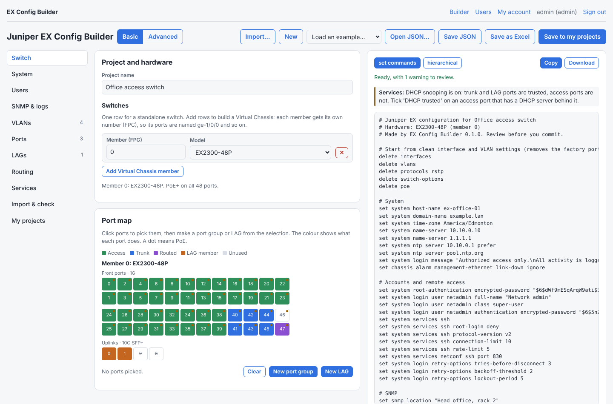
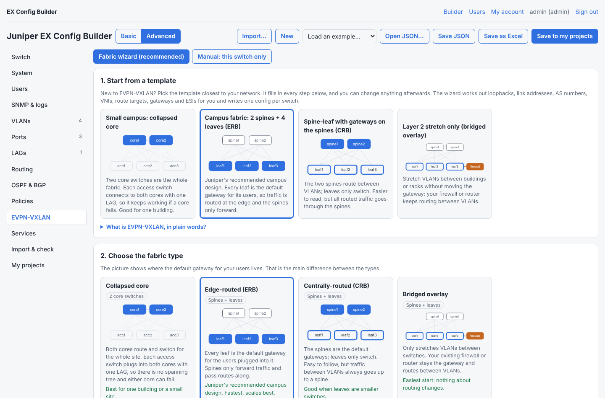
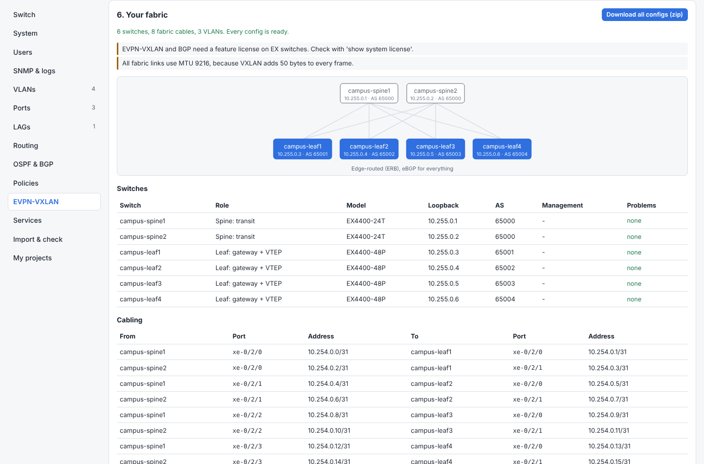

# EX Config Builder

A web GUI (and a small CLI) that builds configuration for **Juniper EX switches**
running Junos with ELS (EX2300, EX3400, EX4100, EX4300, EX4400). Fill in forms, and the
config appears live as `set` commands and as the hierarchical (curly brace)
format, ready to copy or download.



## How to use it

1. **Pick Basic or Advanced** (top left). Basic shows what a normal access switch
   needs: system, users, SNMP and logs, VLANs, ports, LAGs, static routes and
   services. Advanced adds OSPF, BGP, policies, EVPN-VXLAN and the less common
   fields (speed, MTU, MAC limit, VC pre-provisioning and so on). Settings you
   already made stay in the config when you switch to Basic.
2. **Start from something.** Choose a model on the Switch tab, load an example,
   import your current config, or fill in the Excel template (see below).
3. **Work through the tabs.** Click ports on the port map to make a port group or
   a LAG. The config on the right updates as you type, with errors in red
   (Junos would refuse them) and warnings in orange.
4. **Copy or download** the set commands or the hierarchical config, then load it
   on the switch as described in [Applying the config](#applying-the-config-on-a-switch).


### Import and check an existing config

Click **Import…**, paste the output of `show configuration | display set` (or
the curly-brace config), or drop a `.conf`/`.txt` file, then **Check config**.

- Every line is either read into the builder's tabs or listed under "not
  imported", so nothing is lost silently.
- The config gets a score out of 100 and a list of recommendations, the
  important ones first. Examples: Telnet or HTTP turned on, SNMP `public`,
  root SSH login, no NTP or syslog server, no BPDU protection, storm control or
  DHCP snooping, LAGs without LACP.
- **Load as it is** puts the config in the tabs. **Load with recommended fixes**
  also applies the safe fixes (deny root SSH, login retry limits, SSH limits,
  banner, RSTP edge ports, BPDU block, storm control, LLDP).


### Excel workbook

**Import… → Download the Excel template** gives a workbook with a Settings sheet
and one sheet each for Users, SNMP, SNMPv3, VLANs, Ports, LAGs and static
routes, with drop-down lists. Fill it in and drop it on the Import page; the
tabs fill themselves. **Save as Excel** (top right) exports the switch you are
working on in the same format, so you can edit it in Excel and import it again.
OSPF, BGP, policies and EVPN-VXLAN stay in the builder.

### EVPN-VXLAN fabric wizard (Advanced)

The EVPN-VXLAN tab opens with a wizard: pick a template or a fabric type (each
has a small picture showing where the gateway lives), the number of spines and
leaves, the ports between them, and your VLANs and VRFs. It works out every
address, AS number, VNI and route target, draws the fabric, and writes one
config per switch.





## What it covers

| Area | What you can set |
|---|---|
| Hardware | Model (EX2300 / EX3400 / EX4100 / EX4100-F / EX4300 / EX4400, incl. PoE and multigig), Virtual Chassis members, pre-provisioning with serial numbers, a clickable port map |
| System | Host name, domain, time zone, DNS servers and search domains, NTP (preferred server, source address), login banner, management port (me0/em0) with optional management VRF, auto-snapshot |
| Users | Root password and SSH key, local users with class, password and SSH keys. Passwords are turned into SHA-512 (`$6$`) hashes; plain text never reaches the output or a saved project |
| Remote access | SSH root login, connection and rate limits, NETCONF, J-Web, login retry limits |
| SNMP | Location, contact, v2c communities with allowed clients, v3 users (SHA/SHA-2 + AES/DES), v2c trap receivers |
| Logging | Local level, CLI command log, remote syslog servers with facility, level and port |
| VLANs | Name, ID, description, IRB (layer 3) addresses incl. IPv6, DHCP relay, DHCP snooping, ARP inspection, IP source guard |
| Ports | Port groups with ranges (`ge-0/0/0-23`): access (+ voice VLAN), trunk (+ native VLAN), routed (layer 3), disabled; PoE priority/off, speed, MTU, RSTP edge, MAC limit, DHCP-trusted |
| LAGs | ae interfaces with LACP active/passive/static, fast timers, minimum links; trunk, access or routed |
| Routing | Loopback, router ID, AS number, ECMP, IPv4 and IPv6 static routes (next hop, discard, reject, preference), DHCP relay servers |
| OSPF | Areas (normal, stub, NSSA), interfaces, passive and point-to-point interfaces, MD5 keys, reference bandwidth, export policies |
| BGP | Groups (eBGP / iBGP), neighbors with their own AS and description, local address, import/export policies, BFD, multipath, MD5 |
| Policies | Prefix lists, communities, policy statements with terms: from protocol / prefix list / route filter / community, then local preference, MED, community add, next-hop self, accept / reject / next term |
| EVPN-VXLAN | Leaf, collapsed-core or spine (route reflector) role, iBGP or eBGP overlay, VNI per VLAN, anycast gateway (virtual-gateway-address), tenant VRFs with EVPN type-5 routes, ESI-LAG multihoming. EX4100, EX4400 and EX4300-48MP |
| EVPN-VXLAN fabric wizard | Pick a template or a fabric type (collapsed core, edge-routed ERB, centrally-routed CRB, bridged overlay) with a small picture of each, set how many spines and leaves, the ports between them and the VLANs/VRFs. The wizard assigns loopbacks, /31 links, AS numbers, VNIs, route targets, anycast gateways and ESIs, draws the topology, and writes one config per switch (copy, download, zip of all, or open a switch in the builder). Also `POST /fabric` and `/fabric/zip` with `{fabric, base}` |
| Import and check | Read an existing set or curly-brace config into the tabs, score it, list recommendations, load it with or without the recommended fixes, and list the lines it did not import. Also `POST /import/config` with `{text, model}` |
| Excel | Download a template, fill it in and import it; export any project to Excel. `GET /excel/template`, `POST /excel/export`, `POST /import/excel` (file upload) |
| Services | LLDP, LLDP-MED, RSTP with bridge priority and BPDU guard on edge ports, storm control, IGMP snooping, PoE on all ports, disable unused ports, interface ranges |

It checks what you enter as you type: bad addresses, duplicate VLAN IDs, a port
used twice, a missing root password, VLANs that don't exist, ports the model
doesn't have, Virtual Chassis ports used as network ports, PoE on a non-PoE
model and more. Errors are things Junos would refuse; warnings are things to
double check.

Projects can be downloaded and opened as JSON files, or saved on the server
under "My projects" (each user sees only their own).

## Applying the config on a switch

1. Connect to the console or SSH, type `cli`, then `configure`.
2. Paste the **set** commands.
3. `show | compare` to see the change, `commit check` to test it.
4. `commit confirmed 5`. If you lose access, the switch rolls back by itself
   after 5 minutes. If you're still connected, type `commit` to keep it.

For the hierarchical format use `load merge terminal`, paste, then Ctrl+D. On a
factory-new switch, `load override terminal` replaces everything.

"Start with delete interfaces / delete vlans" (on by default) removes the
factory port settings first, so they can't clash with yours. Turn it off when
you only want to add to an existing config.

## Running it

See [INSTALL.md](INSTALL.md). Quick start with Docker:

```
docker compose -f deploy/docker-compose.yml up -d
```

Then open `http://<host>:8088` and sign in as `admin` / `admin`; you're asked
for a new password straight away. Users, two-factor sign-in (TOTP), API tokens
and sign-in lockout work the same as in firewall-converter.

## CLI and API

```
pip install '.[web]'
exbuilder models                                 # list switch models and ports
exbuilder build project.json                     # set commands to stdout
exbuilder build project.json -f hierarchy -o sw1.conf
```

Scripts can call the server with a user name and an API token (from "My account"):

```
curl -u alice:exb_TOKEN -H 'Content-Type: application/json' \
     --data @project.json 'https://exbuilder.example.com/api/generate?format=set'
```

`format=json` (the default) returns the set and hierarchical text, errors,
warnings and generated password hashes.

## Development

```
pip install -e '.[dev,web]'
pytest -q
exbuilder serve          # http://127.0.0.1:8080, data in $EXB_DATA_DIR
```

Layout: `src/exbuilder/models.py` (switch models and port layouts),
`generator.py` (project JSON to config, with all checks), `junos.py` (config
tree that prints set or hierarchical format), `cryptpw.py` (SHA-512 crypt),
`web/` (Flask app, login and the builder page).

Model port layouts are the common factory layouts. A 1G optic in a 10G uplink
is named `ge-` instead of `xe-`; the builder accepts both.
